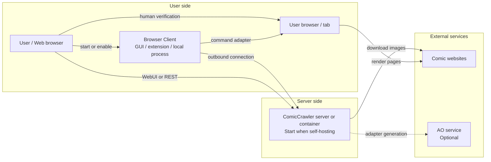
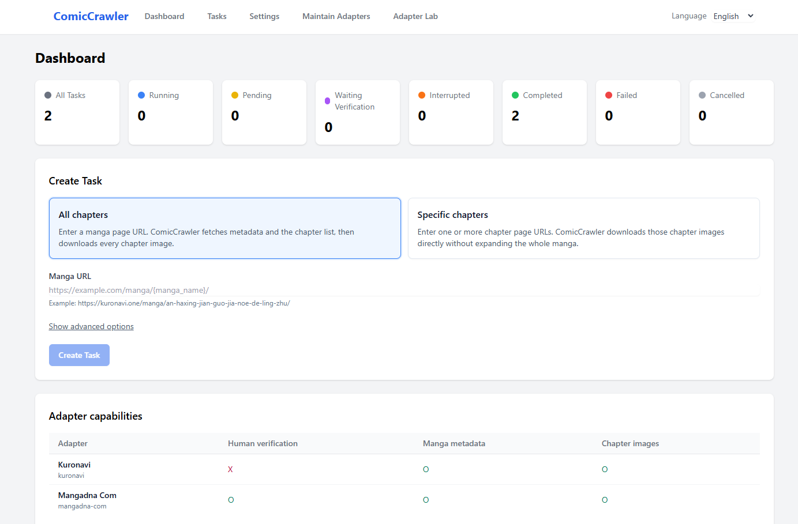
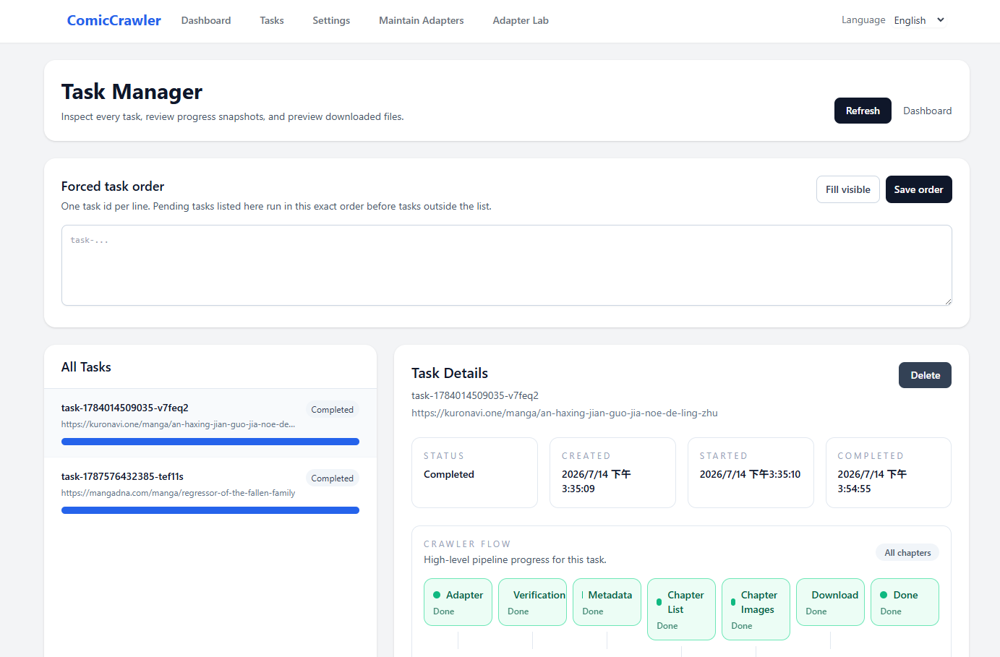
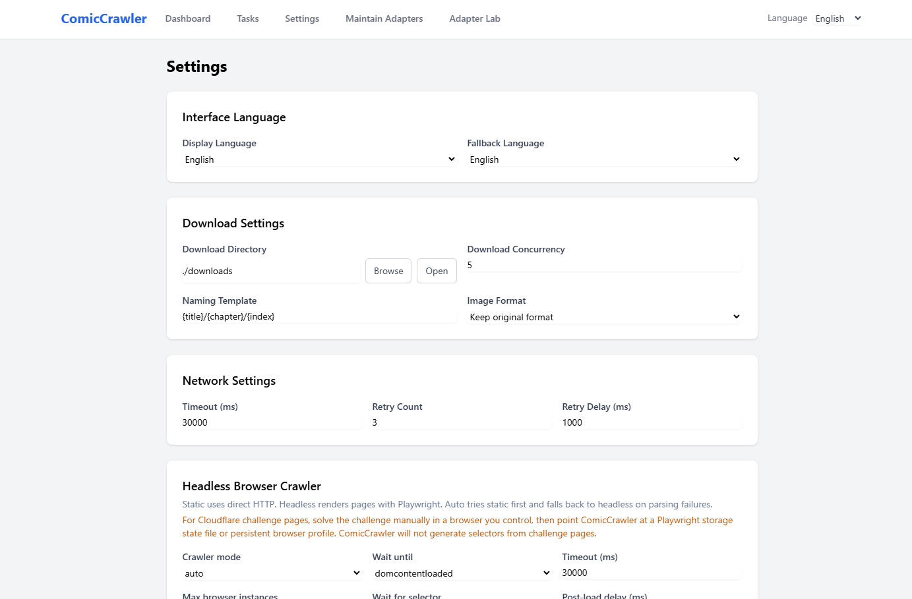
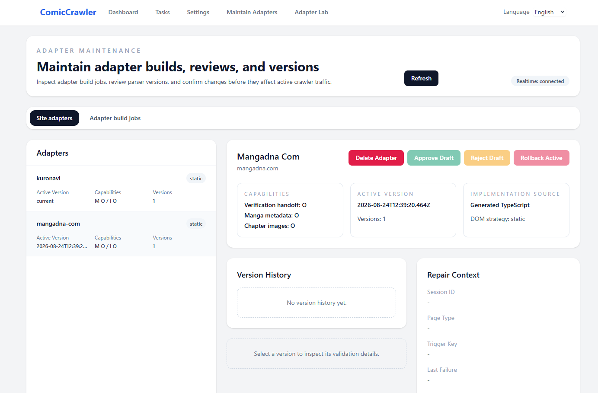
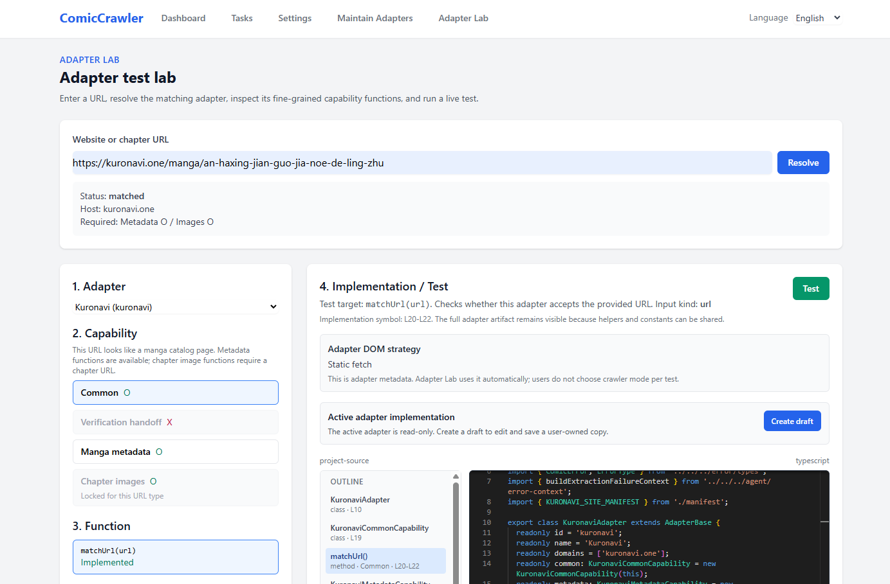

# ComicCrawler

ComicCrawler is a multi-site comic crawler with a WebUI, REST API, adapter
discovery, and user-side browser handoff.

## Command working directory

The source-of-truth repository is the outer workspace's `repo/` directory.
Run Docker and npm commands from there:

```bash
cd repo
```

The command examples below assume the current directory is `repo/`.

## Quick start

### Docker

Build the current source and start the production container:

```bash
docker compose up -d --build
```

Open:

- WebUI: `http://127.0.0.1:4100/`
- REST status: `http://127.0.0.1:4100/api/status`
- Swagger UI: `http://127.0.0.1:4100/api-docs`

Use another host port when `4100` is unavailable:

```bash
COMICCRAWLER_HOST_PORT=4200 docker compose up -d --build
```

PowerShell:

```powershell
$env:COMICCRAWLER_HOST_PORT = "4200"
docker compose up -d --build
```

After pulling new source, rebuild and replace only the application container:

```bash
docker compose up -d --build --force-recreate app
docker compose ps
```

Stop the container:

```bash
docker compose down
```

Docker keeps runtime data and downloads in named volumes.
See the [Docker deployment guide](docs/DOCKER.md) for image metadata, health
checks, log rotation, updates, and data persistence.

### Local development

Requirements:

- Node.js 22.12 or newer.
- npm 9 or newer.

Install and start:

```bash
npm install
npm run dev
```

Open the frontend URL printed by the launcher.
The default URL is `http://127.0.0.1:5173/`.

Use the UTF-8 launcher when PowerShell displays broken text:

```bash
npm run dev:utf8
```

See the [Developer Guide](docs/DEVELOPER_GUIDE.md) for ports, environment
variables, troubleshooting, and verification commands.

## System overview



| Area | What to start or operate |
|---|---|
| User side | Start or enable a Browser Client. Use the WebUI. Complete verification when requested. |
| Server side | Start ComicCrawler only when self-hosting. Cloud users use the existing server. |
| External services | Comic sites need no setup. AO is optional and administrator-managed. |

## Browser Client

ComicCrawler does not launch a browser inside the backend or Docker container.
A user-side Browser Client supplies one task-scoped browser session at a time.

Setup requires three actions:

1. Configure the client.
2. Enroll once, then connect it to the Server.
3. Create a task and select the Worker, or choose any available Worker.

See the [Browser Client SDK guide](browser-client-sdk/README.md) for embedding
instructions and the injected executor contract.

For production environment verification, use the first-party
[Browser Client acceptance consumer](tools/browser-client-acceptance/README.md).
It connects the real SDK and a real headed Chrome to a deployed Server.

## GUI preview

### Dashboard

Create crawl tasks and preview the selected adapter.



### Task Manager

Track progress, inspect results, and resume verification tasks.



### Settings

Configure downloads, browser behavior, and selector discovery.



### Maintain Adapters

Review adapters, build jobs, drafts, and deleted adapters.



### Adapter Lab

Inspect and test individual adapter functions.



## Documentation

### For users

- [User Guide](docs/USER_GUIDE.md): installation, WebUI workflows, downloads,
  and verification handoff.
- [Docker deployment](docs/DOCKER.md): build, update, verify, and operate the
  production container.
- [Browser Client SDK](browser-client-sdk/README.md): enroll, connect, and
  provide a user-side browser.
- [Acceptance Consumer](tools/browser-client-acceptance/README.md): verify a
  deployed Server with the real SDK, WebSocket, and Chrome.
- [API Reference](docs/API.md): REST endpoints and automation flow.
- [API Security](docs/API_SECURITY.md): authentication policy, roles,
  permissions, and credential handling.
- [Swagger UI](http://127.0.0.1:4100/api-docs): live API documentation.

### For developers

- [Developer Guide](docs/DEVELOPER_GUIDE.md): local setup, runtime settings,
  troubleshooting, and test gates.
- [Contributing](CONTRIBUTING.md): contribution rules and pull request checklist.
- [Architecture](docs/ARCHITECTURE.md): components and runtime data flow.
  - [Runtime layout](docs/ARCHITECTURE.md#runtime-layout)
  - [Main flow](docs/ARCHITECTURE.md#main-flow)
  - [Adapters and capabilities](docs/ARCHITECTURE.md#adapters-and-capabilities)
  - [Crawler rendering](docs/ARCHITECTURE.md#crawler-rendering)
  - [Responsive rendering](docs/ARCHITECTURE.md#responsive-rendering)
  - [Browser Client boundary](docs/ARCHITECTURE.md#browser-client-boundary)
  - [Task reliability](docs/ARCHITECTURE.md#task-reliability)
  - [Human verification](docs/ARCHITECTURE.md#human-verification-handoff)
  - [AO discovery](docs/ARCHITECTURE.md#ao-adapter-discovery-and-verification-handoff)
- [Adapters](docs/ADAPTERS.md): adapter contract and capability design.
- [Adapter Packages](docs/ADAPTER_PACKAGES.md): reviewed package format,
  catalog lifecycle, and rollback behavior.
- [AO Selector Discovery](docs/AO_SELECTOR_DISCOVERY.md): generated adapter
  workflow.
- [Reliability](docs/RELIABILITY.md): queue, checkpoint, and resume behavior.
- [Development specifications](docs/development/README.md): SRS, SDD, TDD,
  test scenarios, and credential design.

### Reference

- [Documentation index](docs/README.md)
- [OpenAPI specification](docs/openapi.yaml)
