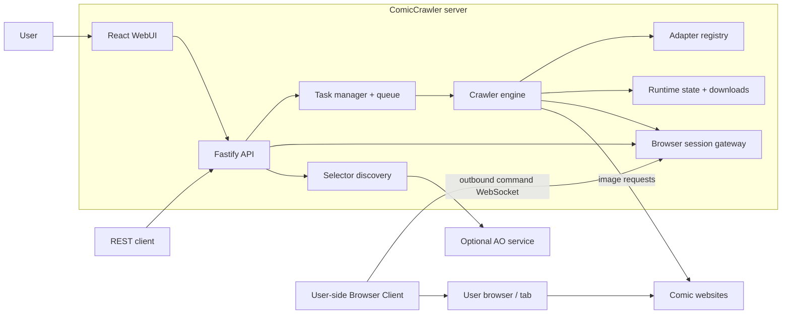
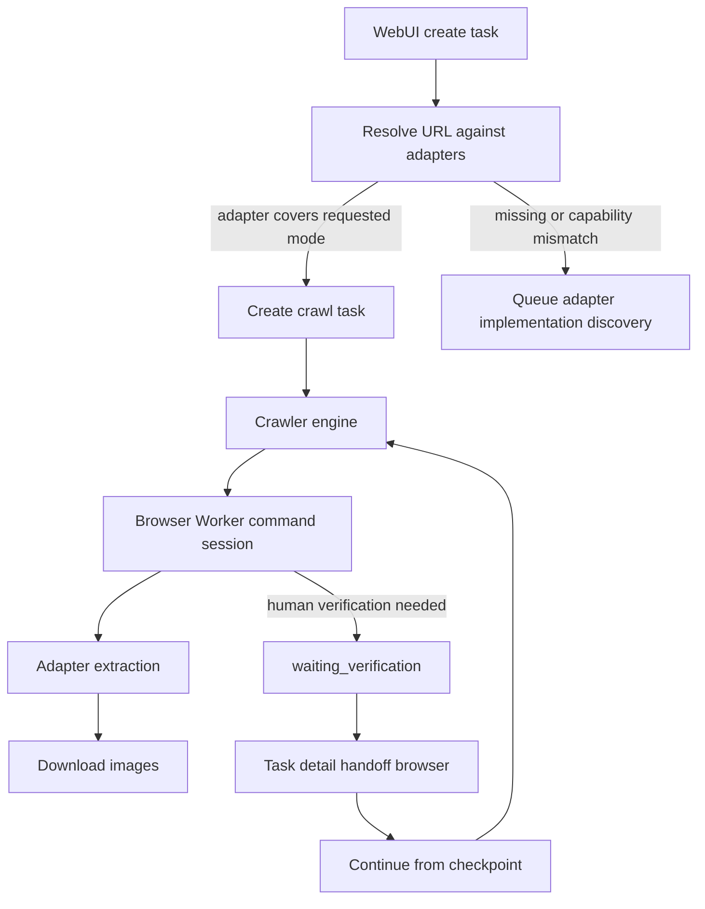
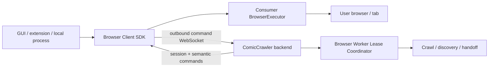

# ComicCrawler Architecture

ComicCrawler is a local-first monorepo application for adapter-based comic
crawling. The current runtime is built around a React WebUI, a Fastify backend,
shared TypeScript types/constants, Playwright-assisted rendering, and AO-assisted
adapter implementation discovery.

## Chapter index

- [System context](#system-context)
- [Startup responsibilities](#startup-responsibilities)
- [Runtime layout](#runtime-layout)
- [Main flow](#main-flow)
- [Adapters and capabilities](#adapters-and-capabilities)
- [Crawler rendering](#crawler-rendering)
- [Responsive rendering](#responsive-rendering)
- [Browser Client boundary](#browser-client-boundary)
- [Task reliability](#task-reliability)
- [Human verification handoff](#human-verification-handoff)
- [AO adapter discovery](#ao-adapter-discovery-and-verification-handoff)
- [Configuration and defaults](#configuration-and-defaults)

## System context



The server owns orchestration and state.
The user device owns the browser process.
The AO service is required only for adapter generation.

## Startup responsibilities

| Component | Production | Development | Owner |
|---|---|---|---|
| ComicCrawler backend | Container process | `npm run dev` | Operator |
| WebUI | Served by backend | Vite dev server | ComicCrawler launcher |
| Browser Client | Separate GUI, extension, or local process | Same | User |
| Browser | Existing or consumer-managed | Existing or consumer-managed | User |
| AO service | Optional external service | Optional fixture or service | Administrator |
| Runtime storage | Named volume or app-data path | `repo/data/` | ComicCrawler backend |

## Runtime layout

```text
repo/
  frontend/        React + Vite WebUI
  backend/         Fastify API, crawler engine, task queue, adapter runtime
  shared/          shared types and defaults
  agent/ao/        AO bundle drafts, skills, agents, contracts, eval cases
  docs/            user/contributor-facing docs
  data/            ignored runtime state
```

`repo/` is the source-of-truth Git root. Runtime data is ignored and not
committed. Development defaults to `repo/data/`; packaged or production runs use
the OS application data directory unless `COMICCRAWLER_DATA_PATH` overrides it.

The resolved data root is organized for new features as:

```text
<data-root>/
  config/           app and integration settings
  user/             user-owned drafts and preferences
  runtime/          task/challenge/checkpoint state
  agent-workspaces/ Agent/AO discovery, fixtures, eval artifacts
  logs/
```

Runtime state is read only from the resolved data root; startup does not scan or
import alternate historical locations.

## Main flow



## Adapters and capabilities

Adapters identify supported domains and declare capabilities:

- `metadata` - extract manga metadata and chapter list from a parsed catalog document.
- `chapterImages` - extract image URLs from a parsed chapter document.
- `verification` - participate in verification handoff.

Runtime adapter code is centered on `AdapterBase`. A site adapter declares its
identity, `parseMode`, capabilities, and fine-grained extraction functions.
ComicCrawler runtime composes those functions into metadata and image results
internally. Agent-generated TypeScript implements the `AdapterBase` capability
contract.

`parseMode` is only the DOM acquisition strategy. Its sole value is
`playwright`, which renders through the task-bound Browser Worker before parsing.
Human verification is modeled separately by `capabilities.verification` and
runtime challenge detection.

Runtime may choose a DOM source, but site-specific strategy belongs in the
adapter implementation or reviewed generated draft. Adapter Lab and runtime do
not perform hidden generic site operations such as scanning and clicking
"show all chapters" controls before calling an extraction function.

All-chapter tasks require metadata and chapter-image support. Specific-chapter
tasks require only chapter-image support. All site adapters are resolved through
the same registry. Implementation source is an internal loading detail. AO
discovery produces TypeScript `AdapterBase` implementation drafts for review.

Project TypeScript adapters are loaded through a project adapter source map at
backend startup, not through hard static imports in the server entrypoint. This
keeps adapter deletion and restart behavior consistent: if an adapter source
directory under `backend/src/adapter/sites/<adapter-id>/` has been deleted, the
startup loader skips it instead of crashing or re-registering it.

Adapter Lab is the human review workbench for this boundary. It displays the
full adapter source, supports user-owned drafts, locks
metadata tests to manga URLs and image tests to chapter URLs, and returns full
`imageUrls` for image extraction tests.

Adapter discovery is intentionally modular:

- Chapter-only discovery is the base unit. It analyzes a chapter reader page and
  produces an adapter implementation for the `chapterImages.extractChapterImageUrls`
  capability.
- Full discovery adds metadata/catalog analysis before the same chapter image
  implementation step. In other words, a full adapter is metadata/chapter-list
  implementation plus one or more chapter-only image extraction checks.

HappyMH is a representative full-adapter case that requires human verification
handoff before the crawler can see real manga DOM. Static probes of its catalog
pages can return a Chinese human-verification page; that HTML must be classified
as anti-bot content and must not be sent into adapter discovery or promoted as
an adapter draft.

## Crawler rendering

The crawler renders pages through a task-bound Browser Worker session. The
Server sends semantic commands such as navigate, wait, bounded content
preparation, get-content, and focus:

- The consumer-owned executor chooses how to drive its browser and returns the
  rendered DOM to the Server.
- There is no static fetch path; every adapter declares `parseMode: playwright`.
  Verification handoff does not introduce another parse mode.

Image downloading remains URL-based. Browser file transfer and screenshot
fallback are not part of the command protocol.

### Responsive rendering

The public chapter-images API adds deterministic opaque chapter/page identities.
It may create an isolated Playwright Browser Context with a caller-supplied
viewport and device scale factor. Viewport
dimensions use CSS pixels. If the request omits them, the effective context is
`1920 × 1080` at scale `1`.

The rendered responsive DOM is passed to the adapter, so media-query and
viewport-driven JavaScript layouts can return different mobile and desktop
image lists. The response reports the effective render context. Adapter
function execution is isolated so concurrent viewport requests cannot replace
each other's renderer.

This is viewport emulation, not complete device emulation. ComicCrawler does
not currently set a mobile user agent, `isMobile`, or `hasTouch`; sites that
branch on those signals may still return their desktop variant.

### Browser Client boundary

The Browser Client SDK is the stable integration boundary for a desktop GUI,
browser extension, or standalone local process. It is runtime-neutral and uses
consumer-injected `BrowserExecutor`, `ClientStateStore`, and optional
`WebSocketFactory` implementations.



The registry persists Browser Client credentials. A live SDK connection creates
a process-scoped Worker identity. A managed-profile job may select any matching
Worker or one Worker ID. An existing-tab job stores an exact `workerId` and
opaque `resourceId`. The lease coordinator never silently replaces that tab or
device. Browser resources exist only in Server memory while their Worker is
connected; native Chrome tab IDs stay inside the consumer.

There is one project WebSocket, owned by the ComicCrawler Server. The protocol
does not tunnel Playwright and does not expose a Playwright endpoint. Browser
profile lifecycle belongs to the consumer. The SDK provides an
`ExistingTabExecutor` for an already-open tab and a `ManagedProfileExecutor`
for a consumer-owned profile launcher. Both use the same semantic command
protocol.

## Task reliability

Crawler and adapter-build work use the shared `TaskScheduler`. Dispatch is a
Strategy: `SchedulingPolicy` is the abstract parent,
`SequentialSchedulingPolicy` runs one task at a time, and
`ConcurrentSchedulingPolicy` controls global and per-group concurrency. Crawler
tasks use task-level concurrency; adapter discovery uses site-level concurrency
and permits only one active build per hostname.

A crawl task with no matching idle Worker is deferred as
`waiting_for_browser_worker`. Deferred tasks remain ordered in the queue but do
not consume a crawler concurrency slot. The scheduler retries on a short timer
until `browser.workerWaitTimeoutMs` expires.

Domain services own task content and state. The scheduler owns ordering,
execution slots, pause/resume, cancellation, and dispatch. Waiting for human
verification or developer review does not occupy a scheduler execution slot.

Tasks persist checkpoint state:

- current chapter
- extracted image list
- completed image indexes and paths
- failed image counts
- latest error and update time

Completed images are skipped on resume. `waiting_verification` keeps the
selected Browser Worker reserved so the handoff cannot be modified by another
task. Unrelated tasks may continue on other idle Browser Workers.

Forced task order is stored separately from normal priority and is used by the
queue when deciding which pending task should run next.

## Human verification handoff

When a matched adapter encounters a human verification page, the task enters
`waiting_verification`. The supported WebUI path is:

1. Open the task detail page.
2. Click **Open browser for verification**.
3. Complete verification in the browser controlled by the selected Browser Client.
4. Click **Continue** to resume from checkpoint.

If the challenge handoff expires or is removed, the task detail page prompts the
user to click **Continue** to recreate the handoff before opening the browser
again.

Crawler rendering, selector discovery, and verification share the task-bound
Browser Worker session. The backend never launches a browser; the browser
process and profile remain on the user-side Consumer Application.

## AO adapter discovery and verification handoff

AO bundle sources live under `agent/ao/`.

- `selector-discovery` produces TypeScript `AdapterBase` implementation drafts
  and Markdown review notes for unknown or capability-missing sites.
- Human verification is handled in the current public flow through handoff jobs
  exposed through the canonical `/api/challenge-discovery/*` resource.
- Restricted challenge strategy drafts are experimental/internal work and
  are not the normal crawl path.

Agent-facing task and review artifacts use Markdown section contracts rather
than JSON contracts. Final adapter implementation output is TypeScript. JSON
remains limited to system settings such as `opencode.json`, provider documents,
API payloads, and internal manifests.

ComicCrawler treats its own workspace and `data/agent-workspaces` as the source
of truth. AO workspaces are short-lived execution surfaces, not persistent
project state.

## Configuration and defaults

Shared runtime defaults live in `shared/constants/index.ts`. Process-level
deployment settings can be overridden by environment variables documented in the
[Developer Guide](DEVELOPER_GUIDE.md). The dev launcher waits for the backend before starting the
frontend, then verifies both services are ready.

## Documentation status

This document describes the current high-level architecture.

- Detailed system design: [SDD](development/SDD.md).
- API schema: [OpenAPI](openapi.yaml).
- Adapter design: [Adapters](ADAPTERS.md).
- AO operation: [AO Selector Discovery](AO_SELECTOR_DISCOVERY.md).
- Runtime recovery: [Reliability](RELIABILITY.md).
