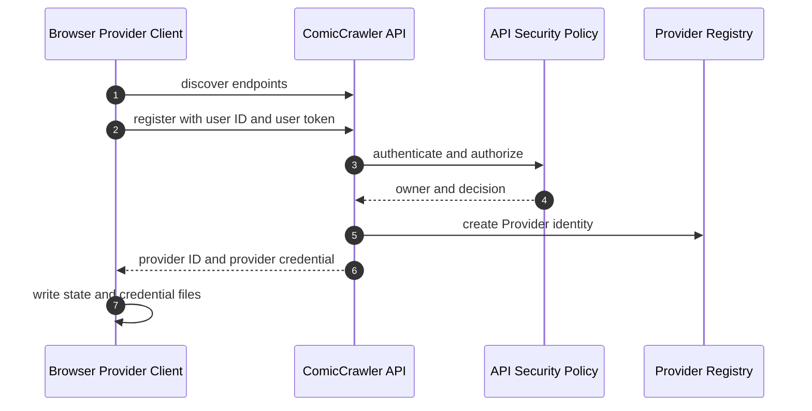

# ComicCrawler 身分、Token 與 Credential

## 1. 目的

本文件定義現行 authentication material 與 runtime identifier。它不記錄已移除的註冊流程，也不列出假想 credential。

## 2. Authentication material

| 名稱 | 是否秘密 | 核發者 | 使用範圍 | 保存位置 |
|---|---|---|---|---|
| User token | 是 | 管理者設定 | User-facing REST API、Provider 初次註冊 | Server secret document；呼叫端自己的 secret storage |
| Provider credential | 是 | ComicCrawler Server | 單一 Provider 的 control／relay WebSocket | Provider credential file、Server runtime storage |

現行 authentication material 只有 user token 與 provider credential。

### 2.1 User token

User token 與 `userId` 成對出現在 Server secret document。Token mode 下，REST caller 以 bearer token 驗證；Server 從 secret object 解析 user、role 與 permissions。

用途：

1. 呼叫被授權的 REST API。
2. 初次註冊 Browser Provider。
3. 判斷 Provider owner。

User token 不用於已註冊 Provider 的長連線。

### 2.2 Provider credential

Provider registration 通過 policy 後，由 Server 為該 Provider 核發 credential。它只代表一個 `providerId`，不能取代 user token 呼叫一般 REST API。

用途：

1. 驗證 outbound control WebSocket。
2. 驗證該 Provider 建立的 reverse relay WebSocket。
3. reconnect 同一 Provider identity。

Provider credential 可 rotation 或 revoke。Rotation 後舊 credential 失效；revoke 後 Server 拒絕新連線並關閉該 Provider 的 live resources。

## 3. Non-secret identifiers

| 名稱 | 擁有者 | 生命週期 | 用途 |
|---|---|---|---|
| `userId` | Server security config | 管理者維護 | REST identity 與 Provider owner |
| `roleId` | Server security config | 管理者維護 | 聚合 permissions 與 limits |
| `providerId` | Provider registration | 直到 revoke／delete | Provider credential subject |
| `workerId` | Browser Worker | Worker identity 存續期間 | 使用者選擇執行裝置 |
| `processInstanceId` | Worker process | 每次 process start | 阻止 stale reconnect |
| `leaseId` | Lease Coordinator | 一個 operation | 保留 Worker capacity |
| `sessionId` | Browser Provider | 一個 Playwright session | relay routing 與 handoff affinity |
| `taskId` | Task Manager | 工作資料存續期間 | 爬蟲工作 identity |
| `challengeDiscoveryId` | Challenge service | handoff 資料存續期間 | 人工驗證 resource |

Identifier 可以出現在 API response 與 log。Secret 不得出現在 log、URL、discovery Markdown 或 adapter draft。

## 4. Endpoint credential matrix

| Endpoint 類型 | Public mode | Token mode |
|---|---|---|
| User-facing REST | Policy 決定 | User token + permission |
| Provider discovery | Policy 決定 | User token 或允許的公開規則 |
| Provider registration | Policy 決定 | User token + register permission |
| Provider control WebSocket | Provider credential | Provider credential |
| Provider relay WebSocket | Provider credential | Provider credential |

Provider WebSocket 不接受 user token。一般 REST API 不接受 provider credential。

## 5. Registration

註冊 response 的 state 與 credential output path 可以由 CLI 指定。Connect command 可以指定 config、state 與 credential path；未指定時使用預設 app-data path。

## 6. Reconnect

1. Client 讀取 provider state。
2. Client 讀取 provider credential。
3. Client 建立新的 `processInstanceId`。
4. Client 以 provider credential 連接 control WebSocket。
5. Server 驗證 provider identity、credential 與 revoke state。
6. Server 以 process instance 判斷是否接受 reconnect。

同一 user 可以同時連接多個 Provider。每個 Provider 都有獨立 `providerId`、credential 與 Worker identity。

## 7. Storage rules

### Server

1. User token 只放在 secret document。
2. Provider credential 使用 Server runtime storage 保存。
3. Secret document 不得由 WebUI 回傳完整內容。
4. Log 必須遮蔽 authorization header 與 credential。

### Provider

1. Config file 不保存 user token。
2. State file 保存非秘密 registration state。
3. Credential file 只保存 Provider authentication material。
4. Credential file 應限制為目前使用者可讀。

## 8. Transport rules

1. Local development可以使用 loopback HTTP／WS。
2. Remote deployment 必須使用 HTTPS／WSS。
3. Token 必須放在 authorization metadata，不得放在 query string。
4. Provider 不得將 Playwright endpoint 直接暴露到公網。
5. Reverse relay 只轉送已授權 session 的 Playwright traffic。

## 9. Terminology

- **Login／authentication**：驗證 user token。
- **Registration／enroll**：建立 Provider identity 並核發 provider credential。
- **Connect**：Provider 以 credential 建立 control WebSocket。
- **Worker selection**：工作選擇 `workerId` 或 `any`。
- **Lease**：Server 保留 Worker capacity。
- **Session**：Provider 建立的 Playwright browser runtime。
