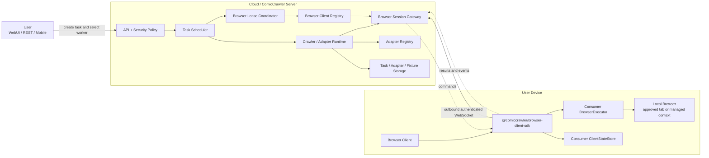
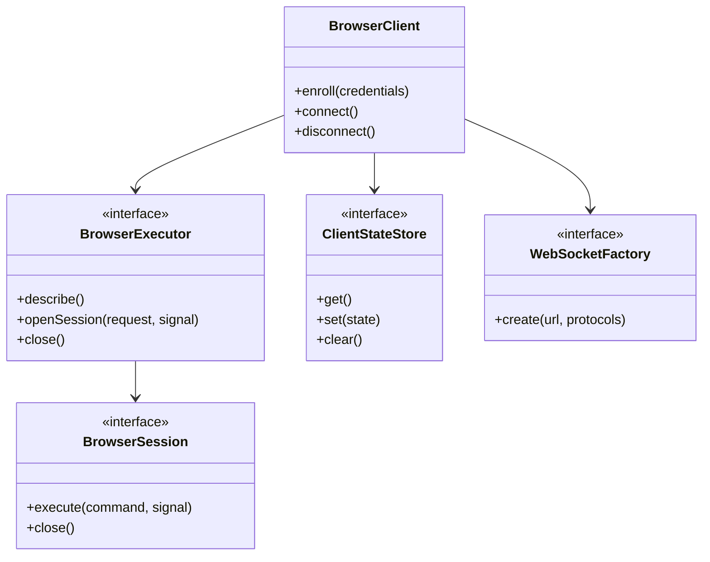
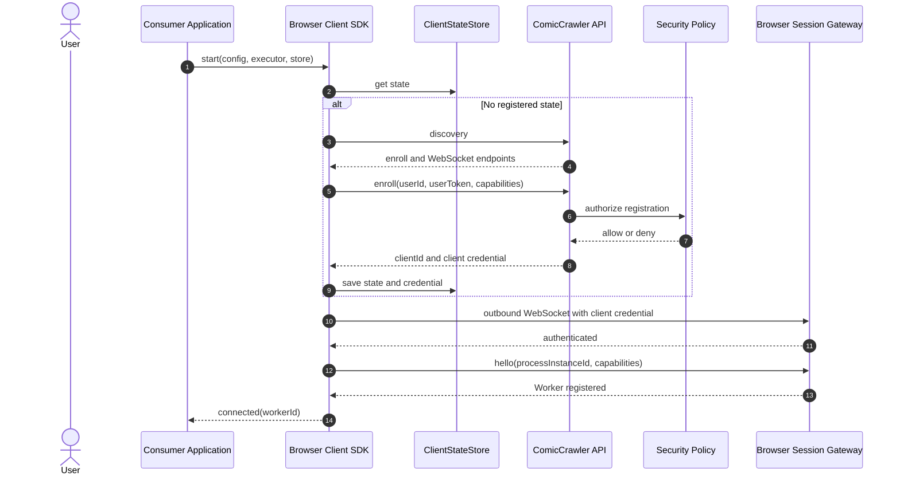
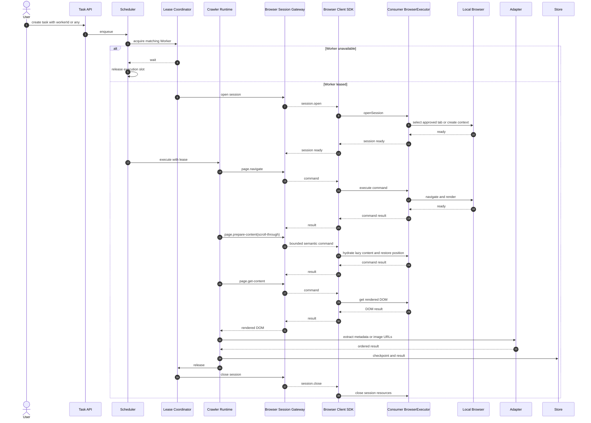
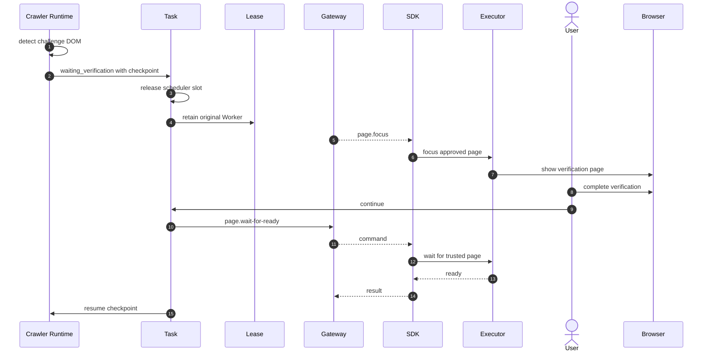
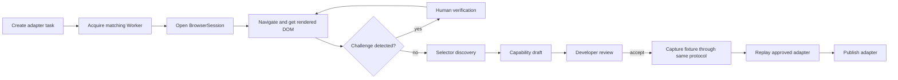
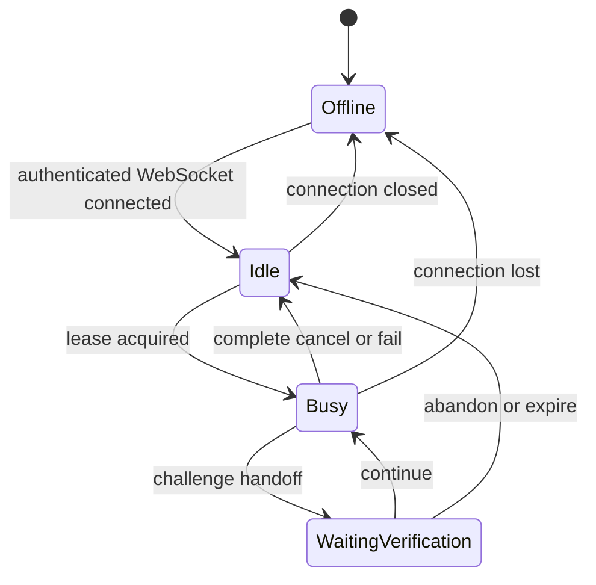
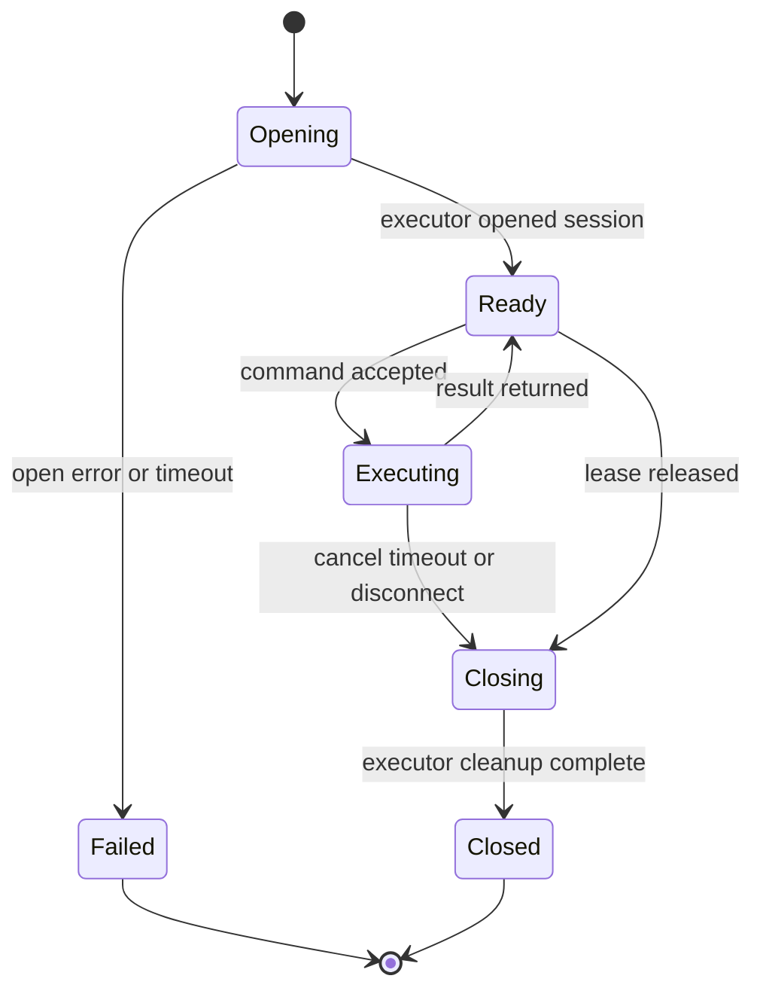

# Browser Client Framework 設計

## 1. 文件狀態

本文件定義 production Browser Client Framework 的實作基線。Runtime 只支援
Version 3 command protocol，不提供舊 protocol 相容層。

Execution mode 與 browser resource 契約見 `BROWSER_EXECUTION_MODES.md`。

目前元件：

- 平台無關 Browser Client SDK 核心。
- Version 3 command、resource 與 control message types。
- Browser Client identity 與 credential registry。
- Browser Session Gateway。
- Browser Worker Lease Coordinator。
- Gateway-based rendered DOM service。
- Enrollment、discovery 與管理 route implementation。
- SDK 到 Gateway 的真實 WebSocket integration test。
- Production bootstrap、crawler、Adapter Lab、selector discovery 與 handoff integration。

## 2. 設計目標

1. ComicCrawler 提供單一 `@comiccrawler/browser-client-sdk` 套件。
2. 所有 Browser Client implementation 使用相同 SDK API。
3. SDK 不依賴 Node、Playwright 或特定瀏覽器平台 API。
4. Consumer 注入 browser executor 與 state store。
5. 使用者端只建立 outbound connection。
6. Cloud 不直接連入使用者裝置。
7. 第一版每個 Worker 同時只執行一個工作。
8. Crawler adapter 繼續在 Cloud 端解析 rendered DOM。
9. Existing-tab Browser Client 可以使用使用者批准的 Chrome tab。
10. Browser operation protocol 保持小型、明確與可稽核。

## 3. 非目標

第一版不提供：

- 完整 Playwright API proxy。
- 任意 JavaScript `evaluate`。
- 任意 filesystem 存取。
- Browser file transfer。
- Cloud 到使用者裝置的 inbound connection。
- 同一 Worker 多工作並行。
- Playwright protocol proxy 相容模式。

## 4. 系統元件



### 4.1 Cloud 元件責任

| 元件 | 責任 |
|---|---|
| API | 驗證使用者並建立工作。 |
| Task Scheduler | 排序、派送、取消與恢復工作。 |
| Browser Client Registry | 保存 client identity 並追蹤在線 Worker。 |
| Browser Lease Coordinator | 將一個工作綁定一個 Worker。 |
| Browser Session Gateway | 收發版本化 browser command 與 result。 |
| Crawler Runtime | 控制頁面取得流程並執行 adapter。 |
| Adapter Runtime | 解析 rendered DOM。 |
| Storage | 保存工作、checkpoint、fixture 與 adapter state。 |

### 4.2 使用者端責任

| 元件 | 責任 |
|---|---|
| Consumer Application | 提供設定、UI、browser integration 與平台生命週期。 |
| Browser Client SDK | 處理註冊、連線、heartbeat、session 與 command dispatch。 |
| BrowserExecutor | 將統一 command 轉成平台 browser 操作。 |
| ClientStateStore | 保存 client state 與 credential。 |
| Local Browser | 執行頁面載入、渲染與人工驗證。 |

## 5. 單一 SDK 套件

所有 Consumer 安裝並匯入同一個套件：

```ts
import {
  BrowserClient,
  type BrowserExecutor,
  type BrowserSession,
  type ClientStateStore,
} from '@comiccrawler/browser-client-sdk';
```

套件只使用跨平台 Web API：

- `fetch`
- `WebSocket`
- `AbortController`
- `TextEncoder`
- `TextDecoder`
- `URL`
- `crypto.subtle`
- `crypto.randomUUID`
- timer API

套件不得直接 import：

- `node:fs`
- `node:path`
- `node:crypto`
- `child_process`
- `playwright`
- `ws`
- `chrome.*`
- `browser.*`

缺少原生 WebSocket 的 runtime 由 Consumer 注入 `WebSocketFactory`。

## 6. SDK 介面



### 6.1 BrowserExecutor

```ts
export interface BrowserExecutor {
  describe(): Promise<BrowserCapabilities>;

  openSession(
    request: OpenBrowserSessionRequest,
    signal: AbortSignal
  ): Promise<BrowserSession>;

  close(): Promise<void>;
}
```

### 6.2 BrowserSession

```ts
export interface BrowserSession {
  execute(
    command: BrowserCommand,
    signal: AbortSignal
  ): Promise<BrowserCommandResult>;

  close(): Promise<void>;
}
```

### 6.3 ClientStateStore

```ts
export interface ClientStateStore {
  get(): Promise<BrowserClientState | undefined>;
  set(state: BrowserClientState): Promise<void>;
  clear(): Promise<void>;
}
```

SDK 不知道 state 位於 file、`chrome.storage`、database 或 secure storage。

## 7. Capability

```ts
export interface BrowserCapabilities {
  executionMode: 'existing-tab' | 'managed-profile';
  navigation: boolean;
  renderedDom: boolean;
  humanHandoff: boolean;
  responsiveViewport: boolean;
}
```

Scheduler 必須在派送前確認 Worker capabilities 滿足工作需求。

注入 existing-tab acquisition strategy 時，Executor 宣告：

```text
executionMode      existing-tab
humanHandoff       true
```

注入 managed-profile acquisition strategy 時，Executor 宣告
`executionMode: managed-profile`。Profile provisioning 與 lifecycle 不放在
capability boolean。

## 8. Version 3 command protocol

### 8.1 Command envelope

```ts
export interface BrowserCommandEnvelope {
  protocolVersion: 3;
  requestId: string;
  leaseId: string;
  sessionId: string;
  command: BrowserCommand;
}
```

### 8.2 Session request

```ts
export interface OpenBrowserSessionRequest {
  sessionId: string;
  leaseId: string;
  source:
    | {
        type: 'existing-resource';
        resourceId: string;
        expectedUrl: string;
        navigationPolicy: 'adopt-current-page';
      }
    | {
        type: 'managed-profile';
        initialUrl?: string;
        navigationPolicy: 'navigate-to-target';
      };
  renderContext?: {
    viewport?: { width: number; height: number };
    deviceScaleFactor?: number;
    isMobile?: boolean;
    hasTouch?: boolean;
    userAgent?: string;
  };
}
```

### 8.3 Result envelope

```ts
export type BrowserResultEnvelope =
  | {
      protocolVersion: 3;
      requestId: string;
      ok: true;
      result: BrowserCommandResult;
    }
  | {
      protocolVersion: 3;
      requestId: string;
      ok: false;
      error: BrowserCommandError;
    };
```

成功結果必須與 command type 相符：

```ts
export type BrowserCommandResult =
  | { type: 'page.navigate'; url: string }
  | { type: 'page.get-url'; url: string }
  | { type: 'page.get-content'; url: string; html: string }
  | { type: 'page.wait-for-ready'; url: string }
  | { type: 'page.prepare-content'; url: string }
  | { type: 'page.focus' };
```

錯誤只使用固定 code，不傳送 stack trace：

```ts
export interface BrowserCommandError {
  code:
    | 'UNSUPPORTED_COMMAND'
    | 'INVALID_STATE'
    | 'LEASE_MISMATCH'
    | 'TIMEOUT'
    | 'CANCELLED'
    | 'NAVIGATION_FAILED'
    | 'BROWSER_CLOSED'
    | 'INTERNAL_ERROR';
  message: string;
  retryable: boolean;
}
```

### 8.4 Commands

```ts
export type BrowserCommand =
  | { type: 'page.navigate'; url: string }
  | { type: 'page.get-url' }
  | { type: 'page.get-content' }
  | { type: 'page.wait-for-ready'; timeoutMs?: number }
  | { type: 'page.prepare-content'; strategy: 'scroll-through'; timeoutMs?: number;
      reader?: { containerSelector?: string; pageSelector?: string; endSelector?: string } }
  | { type: 'page.focus' };
```

Session open 與 close 使用 control message，不混入 page command。

取消 command 使用獨立 control message：

```ts
export interface BrowserCommandCancellation {
  protocolVersion: 3;
  type: 'command.cancel';
  requestId: string;
  leaseId: string;
  sessionId: string;
}
```

Client 依 `requestId` 中止執行中或尚未開始的 command。取消 command 不會
關閉 session；Server 仍會在 task 結束時送出 `session.close`。

`page.prepare-content` 是固定語意操作：在 adapter 宣告的 reader 範圍
依序捲動 page 元素。只有找不到 page 時才執行有界 fallback。完成後會
還原 window 與巢狀容器位置。保留值使用
`data-comiccrawler-src` 與 `data-comiccrawler-image-url` DOM 註記。Protocol
不提供 `evaluate`、`click`、`fill`、download 或任意 script。

### 8.5 Transport authentication

Browser WebSocket API 無法設定任意 HTTP authorization header。

1. Client 建立 WSS connection。
2. Client 以第一個 application frame 傳送 client credential。
3. Server 驗證前不接受 session 或 command message。
4. Server 回傳 `client.authenticated` 與 `workerId`。
5. 認證失敗時 Server 立即關閉 connection。
6. Proxy 與 application log 必須遮蔽第一個 frame 的 credential。

Credential 不放在 URL、query string 或 WebSocket subprotocol。

### 8.6 Command 規則

1. 每個 command 必須有唯一 `requestId`。
2. 每個 command 必須綁定 lease 與 session。
3. SDK 必須一次執行一個 session command。
4. Server 必須設定 timeout。
5. Timeout 或 task cancellation 必須送出 `command.cancel`。
6. Session 關閉後不得接受新 command。
7. Result 必須對應原 request。
8. 未知 protocol version 必須拒絕。
9. 未宣告 capability 的 command 必須拒絕。
10. Log 不得記錄 credential 或完整 DOM。

## 9. Identity 與 state

| 識別碼 | 生命週期 | 用途 |
|---|---|---|
| `userId` | 管理者設定 | REST user 與 Client owner。 |
| `clientId` | 註冊後持久 | 一個已註冊 Browser Client instance。 |
| `workerId` | Client process 存活期間 | 使用者建立工作時選擇的執行目標。 |
| `processInstanceId` | 每次 Consumer 啟動 | 防止舊連線錯誤恢復。 |
| `leaseId` | 一次 task browser ownership | 維持 worker affinity。 |
| `sessionId` | 一次 browser session | command routing。 |
| `requestId` | 一次 command | result correlation。 |

同一 `userId` 可以同時擁有多個 `clientId` 與 Worker。

## 10. 註冊與連線流程



## 11. Crawler task 流程



特定章節工作直接執行 chapter-images capability。全章節工作先取得 metadata 與 chapter list，再逐章載入 rendered DOM。

## 12. Human verification 流程



Cloud 不嘗試自動解決 CAPTCHA。Existing-tab Browser Client 使用目前 Profile 與使用者批准的 tab，因此驗證狀態保留在本機 browser。

## 13. Adapter task 流程



Adapter task 與 crawler task 使用同一個 Scheduler、Lease Coordinator、Gateway 與 SDK protocol。

## 14. Worker 與 session state

### 14.1 Worker



### 14.2 Browser session



## 15. Browser Client 實作

### 15.1 Existing-tab Browser Client

Browser Client 負責：

1. 取得使用者 tab 授權。
2. 實作通用 `BrowserPageDriver`。
3. 建立 `ExistingTabAcquisitionStrategy`。
4. 將 driver 與 strategy 注入 `DriverBrowserExecutor`。
5. 以 `client.registerResource()` 發佈目前 tab。
6. 實作 `ClientStateStore`。
7. 限制操作在批准的 tab。
8. Session 結束時解除控制。
9. 不關閉使用者 Chrome 或刪除使用者 Profile。

### 15.2 Managed-profile Browser Client

CLI、GUI helper 或 local service 負責：

1. 將 Playwright `chromium` 注入 `PlaywrightManagedProfileLauncher`。
2. 選擇 `FreshProfileProvisioner` 或 `CopyProfileProvisioner`。
3. 建立 `ManagedProfileAcquisitionStrategy`。
4. 將 driver 與 strategy 注入 `DriverBrowserExecutor`。
5. 實作 profile directory access。
6. 實作 file、database 或 secure state store。
7. Session 結束時只清理自己擁有的 Profile 與 browser process。

SDK 定義 execution、Playwright 與 Profile Strategy。Node filesystem、
Playwright instance 或其他平台 runtime 皆由 Browser Client 注入。SDK 不要求
existing-tab Consumer 使用特定 browser API 或特定 runtime。

## 16. Security boundary

1. User token 只用於 enroll 與 user-facing API。
2. Client credential 只用於 Browser Client WebSocket。
3. Credential 必須可以 rotation 與 revoke。
4. Cloud 必須檢查 client owner。
5. Worker 只能執行其 owner 的工作。
6. Command 必須綁定 active lease 與 session。
7. Existing-tab Browser Client 必須限制操作在使用者批准的 tab。
8. SDK 不保存完整 DOM 到 log。
9. 第一版不允許任意 script execution。
10. Cloud deployment 必須使用 HTTPS 與 WSS。

## 17. Contract tests

SDK 以 `runBrowserExecutorContract()` 輸出無測試框架依賴的共用
BrowserExecutor contract test harness。Consumer 可以從 Jest、Vitest、
`node:test` 或其他 runner 呼叫相同函式。

共用 harness 驗證：

1. Capability 符合 session source。
2. Existing resource 可以註冊。
3. Session 可以建立。
4. Current URL 可以取得。
5. Rendered DOM 可以取得。
6. Ready state 可以等待。
7. Handoff 可以聚焦原頁面。
8. Navigate 回傳最終 URL。
9. Session close 拒絕後續 command。
10. Existing resource 可以撤銷。
11. Executor 可以關閉。

Gateway 與 Browser Client integration tests 另外驗證單一工作限制、lease
mismatch、timeout、disconnect、reconnect 與 responsive context。

Cloud integration test 必須驗證：

1. Client registration 與 reconnect。
2. Capability matching。
3. Existing-tab Worker 與 resource affinity。
4. Managed-profile Worker selection。
5. Lease 與 session lifecycle。
6. Crawler rendered DOM round trip。
7. Adapter discovery rendered DOM round trip。
8. Human verification resume。
9. Cancellation 與 timeout。
10. Credential revoke。

## 18. Runtime 不變條件

1. Production 只掛載一個 Browser Client WebSocket。
2. 第一個 WebSocket frame 必須完成 Client credential 驗證。
3. Worker 同時只能持有一個 active session。
4. Session 必須綁定 lease ID 與 task。
5. Command 必須依序執行。
6. Disconnect 必須使未完成 command 失敗。
7. 同一 process reconnect 才可維持 Worker affinity。
8. Server 不可取得任意 Playwright API。
9. 新 process 只能透過顯式、驗證過的 task target rebind 接手。
10. Scheduler 不得自動替換 existing-tab target。

## 19. 驗收條件

1. 所有 Consumer 使用同一 SDK package root。
2. SDK build 不包含 Node、Playwright 或特定瀏覽器平台 runtime dependency。
3. 使用者裝置不開放 inbound port。
4. Existing-tab Browser Client 可以使用批准 tab 的現有 Profile state。
5. Node Consumer 可以用獨立 Executor 管理 browser。
6. Crawler 與 adapter task 共用同一 command protocol。
7. Scheduler 保證每個 Worker 一次一個工作。
8. Handoff 使用原 Worker 與 session。
9. Server 不包含 browser protocol relay code。
10. Unit、contract、integration 與 E2E tests 全部通過。
