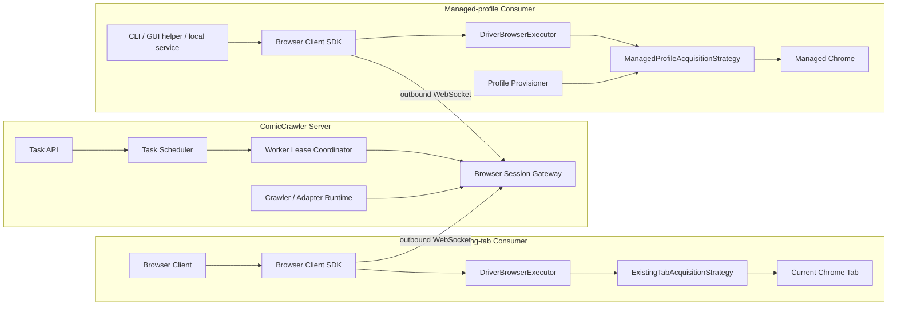
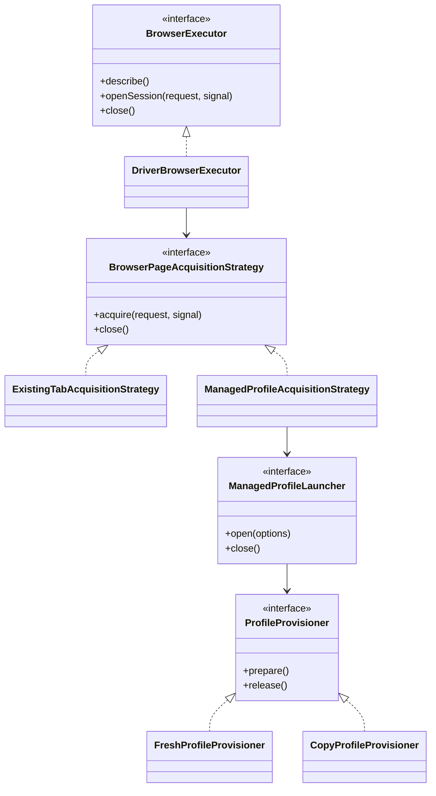
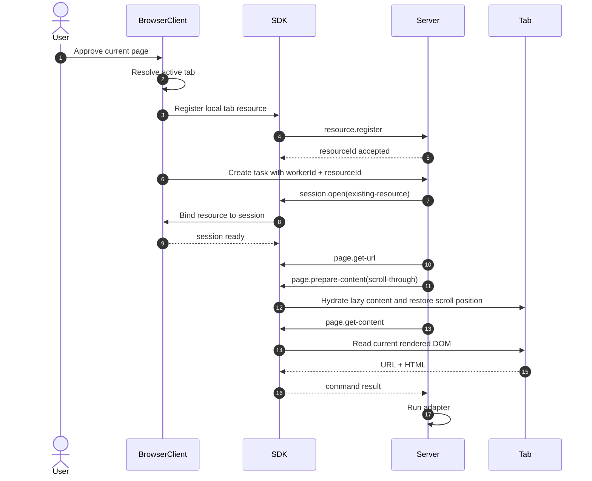
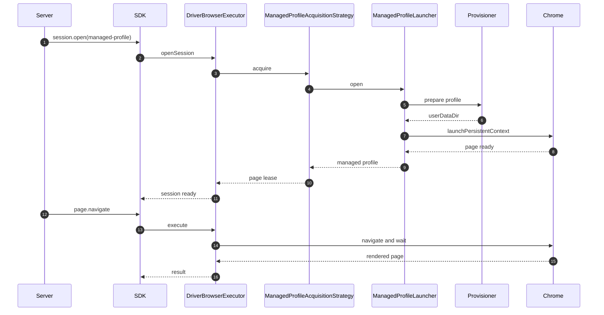

# Browser Execution Modes

## 1. 文件狀態

本文件定義 Browser Client execution mode 的 production 契約。

- Runtime 使用 Version 3 protocol。
- Server 不支援 Version 1 相容層。
- SDK、Gateway、task target 與 page acquisition 已採用本契約。
- 同一 SDK package 已提供通用 existing-tab contract、Playwright driver/launcher
  與 fresh/copy Profile provisioner。
- Browser runtime instance 與 filesystem operation 由 Consumer 注入。
- 本文件不記錄開發過程或歷史方案。

## 2. 問題定義

Browser Client 必須涵蓋兩類不同情境：

1. 使用者已在 Chrome 開啟目標頁面。
2. 使用者尚未開啟任何可供爬取的頁面。

第一類使用 existing-tab Browser Client。它應採用目前 tab、目前 Profile
與目前驗證狀態。建立 session 時不得另外啟動 Chrome。

第一方 acceptance Consumer 可以在連線時建立自己擁有的 Chrome，讓使用者先
開啟頁面。頁面註冊後仍採用相同 existing-tab 契約。

第二類以 CLI、GUI helper 或 local service 為主要 Consumer。它應由本機
Playwright 啟動 ComicCrawler 管理的 Chrome Profile。

Server 只處理 browser command，不依賴瀏覽器平台 API 或 Playwright
API。

## 3. 設計決策

1. Browser execution mode 使用 Strategy Pattern。
2. Runtime mode 只有 `existing-tab` 與 `managed-profile`。
3. `fresh` 與 `copy` 是 Profile provisioning policy。
4. Task 建立時固定 Worker、mode 與 browser resource。
5. Task 執行期間禁止自動切換 mode。
6. Handoff 必須沿用原始 BrowserSession。
7. Existing tab 的第一次 DOM 取得不得重新導頁。
8. Server 使用相同 command protocol 控制所有 mode。
9. Adapter 只解析 rendered DOM，不依賴 Browser driver。
10. 不提供完整 Playwright API proxy。

## 4. 非目標

本設計不提供：

- Cloud 到使用者裝置的 inbound connection。
- Playwright remote service relay。
- 自動附加一般 Chrome 的 remote-debugging port。
- Task 執行期間的 mode fallback。
- BrowserSession 在不同 Worker 間遷移。
- 自動解決 CAPTCHA 或人工驗證。
- 複製正在寫入中的 Chrome Profile。
- 任意 JavaScript command。

## 5. 系統架構



## 6. Execution mode

```ts
export type BrowserExecutionMode =
  | 'existing-tab'
  | 'managed-profile';
```



### 6.1 Existing tab

適用情境：

- 使用者透過 Browser Client 批准目前漫畫分頁。
- 頁面已登入或已通過反爬蟲驗證。
- 使用者希望在同一頁完成後續人工驗證。

責任：

- Browser Client 取得使用者批准的目前 tab。
- Executor 將 tab 綁定到 BrowserSession。
- Session 初次建立時不得重新導頁。
- Session 結束時不得關閉 tab。
- Handoff 只聚焦原 tab。
- DOM 由目前 tab 讀取。

基礎操作由 Consumer 注入的 `BrowserPageDriver` 完成。Driver 可以包裝
Consumer 所在平台提供的 page handle，或包裝 acceptance runtime 擁有的
Playwright page。Server 只傳送 semantic commands，不知道底層 API。

### 6.2 Managed profile

適用情境：

- REST、CLI 或 WebUI 建立工作。
- 沒有可採用的既有 tab。
- Consumer 可以在本機啟動 Chrome process。

責任：

- 使用本機 Playwright `launchPersistentContext()`。
- 使用本機安裝的 Chrome channel。
- Profile 位於 Consumer 管理的資料目錄。
- Browser 必須以 headed mode 支援 handoff。
- Session 關閉時只清理 Consumer 擁有的資源。

已驗證 prototype 的主要設定：

```ts
chromium.launchPersistentContext(userDataDir, {
  channel: 'chrome',
  headless: false,
  args: ['--disable-blink-features=AutomationControlled'],
});
```

Prototype 顯示 fresh 與 copied Profile 都可能在沒有人工點擊的情況下通過
目標網站驗證。正式 acceptance test 仍必須檢查 reader DOM，不能只以
`page.goto()` 未拋出錯誤判定成功。

## 7. Profile provisioning

Provisioning 只在建立 managed Profile 時執行，不影響 crawler command。

```ts
export type ManagedProfileProvisioning =
  | {
      type: 'fresh';
    }
  | {
      type: 'copy';
      sourceUserDataRoot: string;
      sourceProfile: string;
    };
```

### 7.1 Fresh provisioner

1. 建立新的 user data directory。
2. 建立 `Default` Profile。
3. 不讀取使用者既有 Chrome 資料。
4. 將目錄交給 `ManagedProfileAcquisitionStrategy` 的 launcher。

### 7.2 Copy provisioner

1. 解析來源 User Data root。
2. 確認來源 Profile 存在。
3. 確認來源 Chrome 未持有 Profile lock。
4. 複製 Profile 資料。
5. 排除 cache、lock 與 telemetry 檔案。
6. 同步根目錄 `Local State`。
7. 驗證複製後的 Profile 結構。
8. 將新目錄交給 `ManagedProfileAcquisitionStrategy` 的 launcher。

Copy 失敗時回傳明確錯誤。Runtime 不得自動改用 fresh Profile。

### 7.3 Profile lifecycle

- BrowserSession 建立時準備 Profile。
- BrowserSession 關閉後刪除 Profile。
- Profile 不跨 BrowserSession 重用。
- Fresh 與 copy 只影響 Profile 準備方式。
- Existing-tab mode 才沿用使用者原有 Profile state。

## 8. Capability contract

現行 `existingTabs` 與 `persistentProfile` boolean 無法表達明確的 execution
mode。新契約改為 discriminated field：

```ts
export interface BrowserCapabilities {
  executionMode: BrowserExecutionMode;
  navigation: boolean;
  renderedDom: boolean;
  humanHandoff: boolean;
  responsiveViewport: boolean;
}
```

Capability 規則：

- `ExistingTabAcquisitionStrategy` 設定 `executionMode: 'existing-tab'`。
- `ManagedProfileAcquisitionStrategy` 設定 `executionMode: 'managed-profile'`。
- `DriverBrowserExecutor` 回報所注入策略的 capability。
- Worker 不得在同一次 process lifetime 改變 execution mode。
- Server 派送前必須檢查 task requirement。

## 9. Browser resource

Existing tab 是由 Consumer 擁有的 process-memory resource。Server 只保存
不透明 ID，不保存 Chrome `tabId`。

```ts
export interface BrowserResource {
  resourceId: string;
  workerId: string;
  kind: 'tab';
  url?: string;
  registeredAt: string;
}
```

規則：

1. Resource 必須屬於已認證 Worker。
2. `resourceId` 只在 Worker process 存活期間有效。
3. Consumer 維護 `resourceId` 到本機 `tabId` 的 mapping。
4. Server 不得接收或持久化原始 `tabId`。
5. Tab 關閉時 Consumer 必須撤銷 resource。
6. 使用者撤銷授權時 Consumer 必須關閉 session。

## 10. Task target

```ts
export type BrowserTarget =
  | {
      mode: 'managed-profile';
      workerId?: string;
    }
  | {
      mode: 'existing-tab';
      workerId: string;
      resourceId: string;
    };
```

約束：

- Existing-tab Browser Client 建立的 task 必須指定 `workerId + resourceId`。
- `resourceId` 只能搭配 existing-tab Worker。
- Managed-profile task 不帶 `resourceId`。
- 省略 target 時只選 managed-profile Worker。
- 指定的 target 不得被其他 Worker 取代。
- Resource 消失時 task 等待原 Worker 或依 policy 失敗。

### 10.1 Process restart recovery

Process restart produces a new `workerId` and `resourceId`. Recovery is always
explicit:

1. Consumer reconnects with its saved Client credential.
2. User approves the current tab again.
3. Consumer registers a new resource.
4. Consumer reads the task's current target.
5. Consumer calls `rebind-browser-target` with old and new targets.
6. Server validates ownership, URL, capability, state, and concurrency.
7. Server persists `task:browser_target_rebound`.
8. Scheduler continues only with the supplied target.

The old target is an optimistic concurrency precondition. The scheduler never
chooses a replacement. Browser-native tab IDs remain local to the Consumer.

Allowed states are `waiting_for_browser_worker`, `interrupted`,
`waiting_verification`, and browser-target-loss `failed`. A running or terminal
task rejects the operation. A waiting handoff closes its old session and reuses
the persisted handoff record with the newly approved resource.

## 11. Session source

```ts
export type BrowserSessionSource =
  | {
      type: 'existing-resource';
      resourceId: string;
      navigationPolicy: 'adopt-current-page';
    }
  | {
      type: 'managed-profile';
      initialUrl?: string;
      navigationPolicy: 'navigate-to-target';
    };
```

`OpenBrowserSessionRequest` 必須帶入 `source`。Executor 不得猜測 session
來源。

## 12. Page acquisition

BrowserRenderService 由 Gateway 對每個 session 記錄第一次 page
acquisition，navigation 與 DOM snapshot 不再綁死。

規則：

- Existing tab 第一次 acquisition 比對目前 URL，符合時直接讀取 DOM。
- Existing tab 第一次 acquisition 不符合 task URL 時回傳 mismatch error。
- Managed profile launcher 只建立 Profile 與 page。
- Managed profile acquisition 只建立 page，不負責 navigation。
- Browser Render Service 在目前 URL 不同時送出 `page.navigate`。
- Handoff 只 focus 或 snapshot，不執行 navigation。

## 13. Existing-tab task 流程



## 14. Managed-profile task 流程



## 15. Human verification

所有 mode 使用相同 handoff state machine：

1. Runtime 偵測 challenge DOM。
2. Task 保存 checkpoint。
3. Scheduler 釋放 execution slot。
4. Lease 保留原 Worker 與 BrowserSession。
5. Server 送出 `page.focus`。
6. Executor 顯示原始頁面。
7. 使用者完成驗證。
8. Resume 只取得目前 URL 與 DOM。
9. Runtime 確認 challenge 已消失。
10. Task 從 checkpoint 繼續。

Handoff 禁止：

- 重新建立 BrowserSession。
- 切換 Worker。
- 切換 execution mode。
- 未經要求重新 navigation。
- 建立新的驗證頁面。

## 16. Adapter contract 影響

Adapter 不應知道 DOM 來自 managed profile 或 existing tab。

目標設計移除 `parseMode: 'playwright'`。所有 adapter 直接接收 Browser Client
回傳的 rendered DOM。

切換時：

1. 移除 shared adapter `parseMode` field。
2. 移除 project adapter 中的 `parseMode`。
3. 移除 Adapter Lab 的 DOM strategy 顯示。
4. 移除 AO draft 中的 `parseMode` contract。
5. 不提供 `playwright` alias。

## 17. Protocol 變更

新設計需要加入：

- Worker `executionMode`。
- Resource register／revoke message。
- Session source。
- Navigation policy。
- Resource lifecycle event。

Protocol 採新版本一次性切換。Server 不同時接受舊 message shape。

## 18. Failure policy

| Failure | Result |
|---|---|
| Existing tab 已關閉 | Session 失敗；task 保留錯誤。 |
| Existing-tab Browser Client 權限被撤銷 | Session 失敗；不得改用 managed profile。 |
| Source Profile locked | Copy provisioning 失敗。 |
| Managed Profile locked | Worker 回報 busy／profile locked。 |
| Chrome 啟動失敗 | Session open 失敗。 |
| Worker disconnect | 等待同一 process reconnect。 |
| Resource 不屬於 Worker | Server 拒絕 task target。 |
| Handoff URL 不符 | 回報 page mismatch；不得自動導頁。 |

## 19. Security boundary

1. Existing tab 必須由使用者動作批准。
2. Browser Client 只操作已註冊 resource。
3. Server 不保存本機 tab ID。
4. Worker 只能註冊自己的 resource。
5. Task owner 必須等於 Worker owner。
6. Session 必須綁定 lease 與 resource。
7. DOM 不寫入一般 application log。
8. Profile path 不傳送到 Server。
9. Copy source path 只保留在本機設定。
10. Client credential 與 user token 分開保存。

## 20. Test strategy

### 20.1 Contract tests

每個 Executor 必須通過同一套 contract tests：

1. 建立 session。
2. 取得目前 URL。
3. 取得 rendered DOM。
4. 執行 navigation。
5. 聚焦相同頁面。
6. 依序執行 command。
7. 關閉 session。
8. 拒絕 lease mismatch。

### 20.2 Existing-tab tests

1. 使用者批准目前 tab。
2. Browser Client 註冊 resource。
3. Task 綁定 resource。
4. 第一次 acquisition 不重新導頁。
5. Handoff 聚焦相同 tab。
6. Session close 不關閉 tab。
7. Tab close 撤銷 resource。

### 20.3 Managed-profile tests

1. Fresh provisioner 建立 Profile。
2. Copy provisioner 拒絕 locked source。
3. Copy provisioner同步 Local State。
4. Executor 啟動 headed Chrome。
5. Session 重用相同 context。
6. Session lifecycle 清理臨時 Profile。

### 20.4 Live acceptance

Live anti-bot acceptance 不進入一般 CI。第一方 acceptance Consumer 使用正式
SDK、WebSocket、Server、Adapter Lab 與 Chrome。

1. 使用獨立 config enroll 兩種 execution mode。
2. 以 existing-tab 註冊並選定目標 tab。
3. 以 managed-profile 建立 session-owned page。
4. 驗證兩種模式的 adapter result。
5. 驗證 handoff 沿用原 browser session。
6. 驗證各模式的資源清理規則。

完整操作步驟見
[`tools/browser-client-acceptance/README.md`](../../tools/browser-client-acceptance/README.md)。
測試不得只以 navigation 未拋出錯誤作為通過條件。

## 21. 固定決策

1. Managed Profile 預設 lifecycle 使用 `session`。
2. Copy provisioner 複製完整 Profile，但排除 cache。
3. Existing tab 不限定 Consumer 使用的 browser API。
4. Resource registration 使用既有 control WebSocket。
5. Existing tab 第一次 acquisition 必須符合 task URL。
6. Mobile Consumer 第一版只作 task controller。

## 22. References

- [Browser Client acceptance guide](../../tools/browser-client-acceptance/README.md)
- [Playwright BrowserType](https://playwright.dev/docs/api/class-browsertype)
