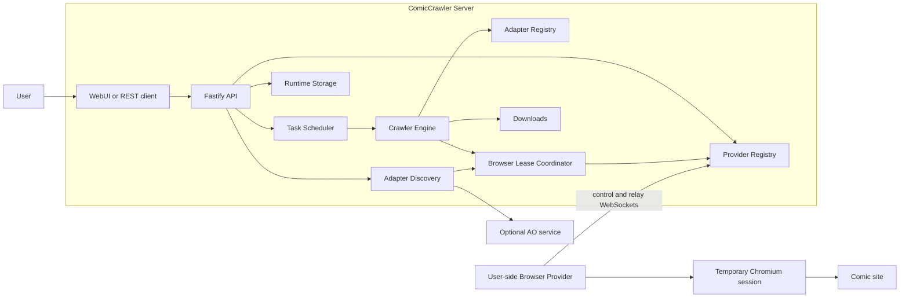
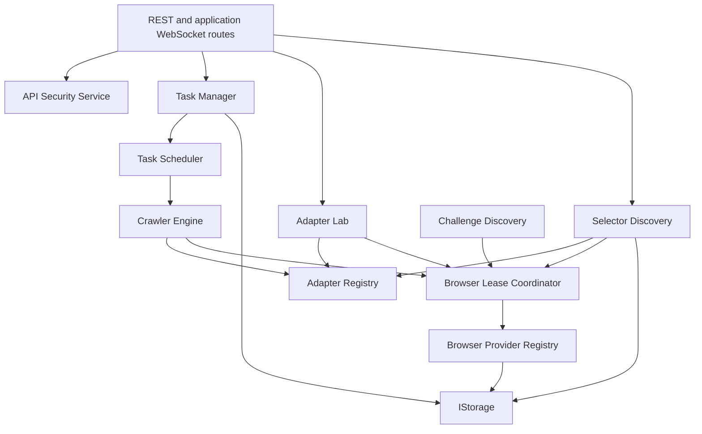
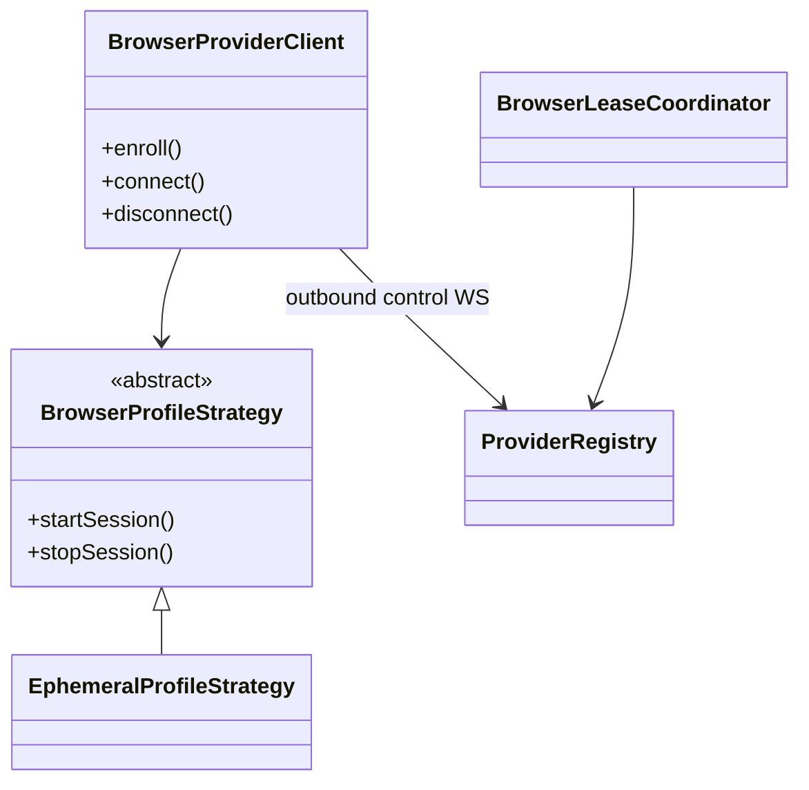
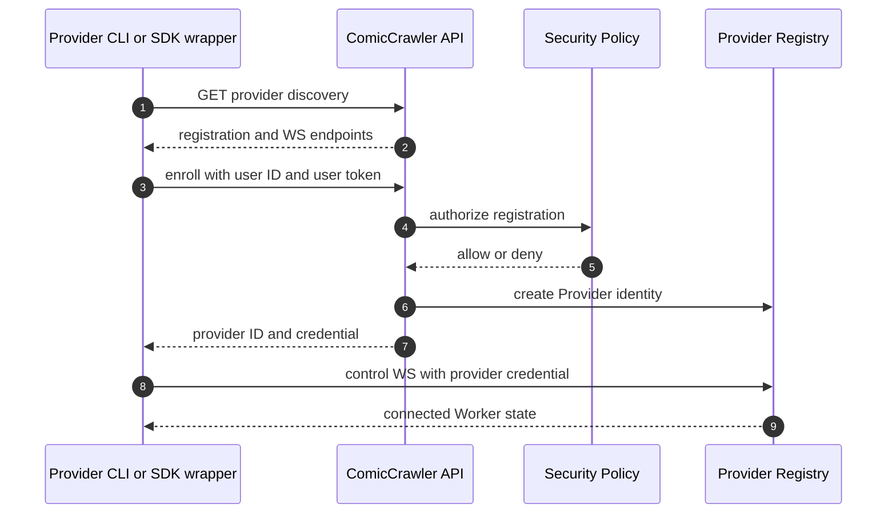
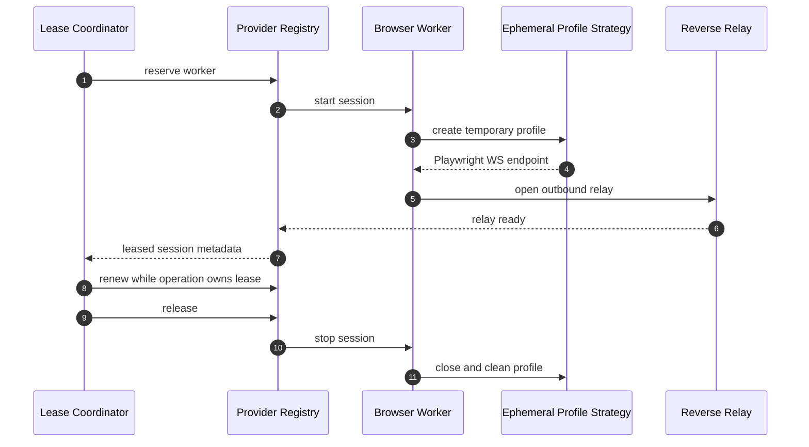
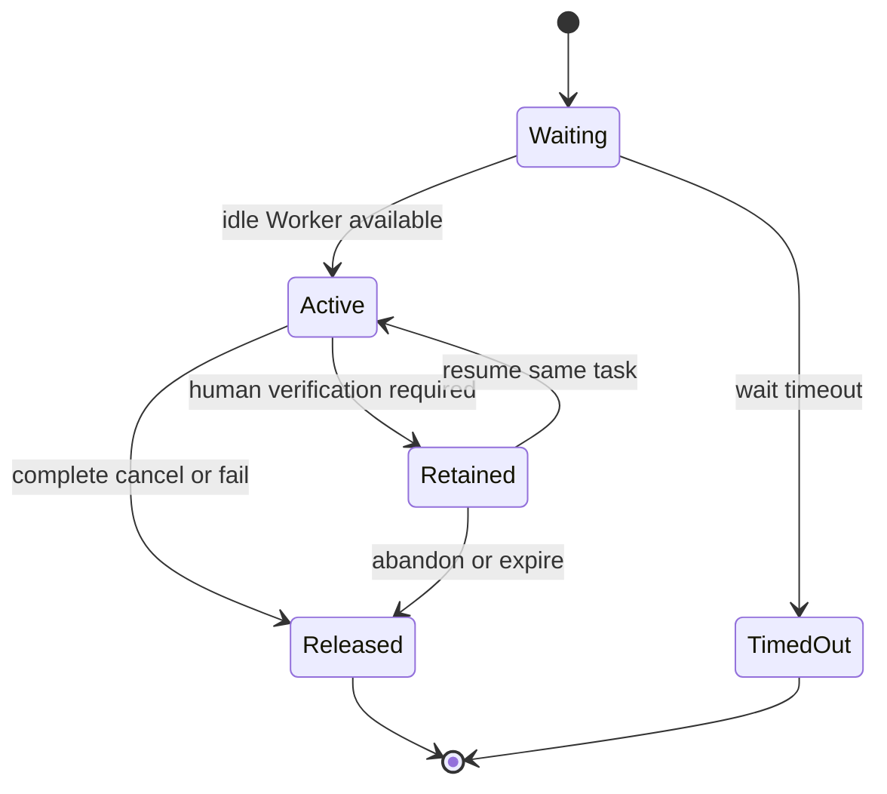
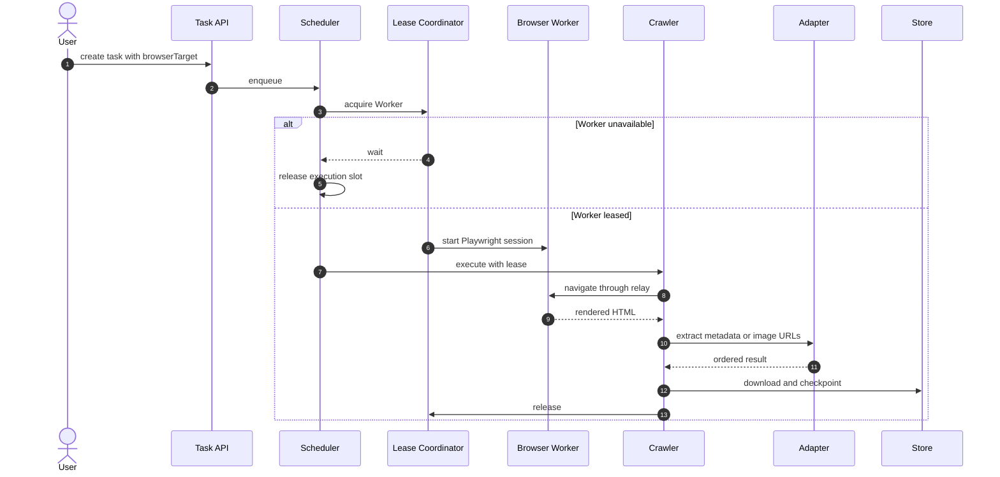
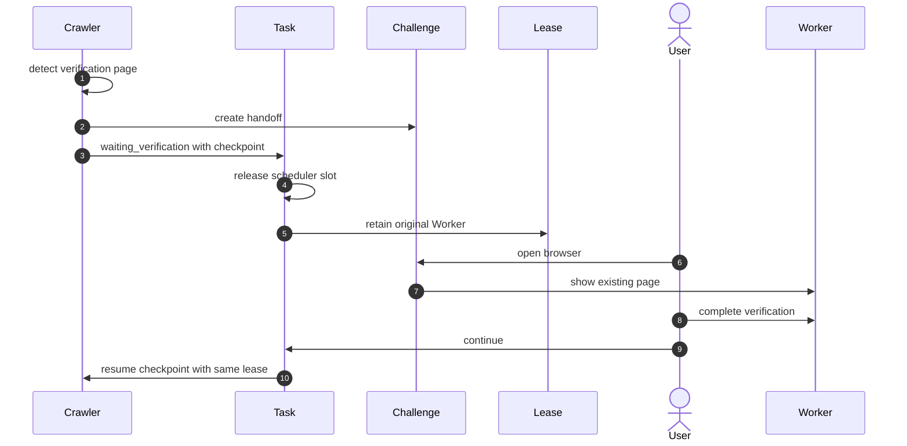

# ComicCrawler 系統設計

## 1. 文件邊界

本文件描述目前執行中的系統設計。公開操作文件位於上一層目錄；API schema 以 [OpenAPI](../openapi.yaml) 為準。

## 2. 設計原則

1. Server 負責 orchestration，使用者裝置負責 browser runtime。
2. 所有 adapter DOM acquisition 統一使用 Playwright。
3. Browser Provider 只建立 outbound connection。
4. 工作選擇 Browser Worker，不直接選擇內部 session。
5. Browser lease 與工作生命週期相連。
6. 等待外部動作時釋放 scheduler slot。
7. Agent 產物必須經 fixture 與人工審核。
8. 安全決策由 policy 與 credential type 明確區隔。

## 3. 系統環境



### 3.1 部署責任

| 元件 | 位置 | 啟動者 |
|---|---|---|
| Backend + production WebUI | Server process／container | Operator |
| Frontend dev server | Developer machine | Developer |
| Browser Provider | User device | User or wrapper application |
| Chromium | User device | Browser Provider |
| AO service | External or local service | Administrator |

Production backend 預設監聽 `127.0.0.1:4100`。Frontend development server 預設使用 `5173`。

## 4. Backend 元件



### 4.1 Scheduler

`TaskScheduler` 管理工作排序、execution slot、取消、暫停與恢復。`SchedulingPolicy` 是替換點：

- `SequentialSchedulingPolicy`：一次執行一個工作。
- `ConcurrentSchedulingPolicy`：限制全域及 group concurrency。

Crawler task 使用 task group。Adapter discovery 使用 hostname group。`waiting_for_browser_worker`、`waiting_verification` 與 developer review 不占 execution slot。

## 5. Browser Provider protocol

### 5.1 元件



目前只有 `EphemeralProfileStrategy`。每個 Playwright session 使用新臨時 profile，session 結束後關閉 browser 並清理 profile。不支援複製 profile、persistent user-data directory 或 attach 到使用中的 Chrome。

### 5.2 Discovery、registration 與 connect



Provider config 保存 Server URL 與非秘密設定。State 保存 Server 核發的 provider ID。Credential file 保存 provider credential。未指定 state／credential 路徑時，CLI 使用預設 app-data 路徑。

### 5.3 Worker identity

| 識別碼 | 用途 |
|---|---|
| `userId` | REST user 與 Provider owner |
| `providerId` | 已註冊 Provider instance |
| `workerId` | 可被工作選擇的 Browser Worker |
| `processInstanceId` | 區分 Worker process restart |
| `leaseId` | Server 內部工作租約 |
| `sessionId` | Provider 內部 Playwright session |

使用者建立工作時選擇 `workerId` 或 `any`。`leaseId` 與 `sessionId` 是內部 routing data，不是工作建立 API 的輸入。

### 5.4 Control 與 reverse relay

Provider control WebSocket 傳送 session start、renew、stop 與狀態命令。Reverse relay WebSocket 傳送 Playwright protocol bytes。兩者都由 Provider 主動連向 Server；使用者裝置不暴露 endpoint。



## 6. Browser lease state

每個 Worker 第一版 capacity 為一。Lease state 只保證 Server 與 Provider process 存活期間的連續性。



Specific target 不可被其他 Worker 取代。`any` 只在第一次 acquire 時選擇 Worker；取得後同樣維持 affinity。

## 7. Crawl flow



特定章節流程直接執行 chapter-images capability。全章節流程先執行 metadata capability 取得 chapter list，再逐章執行 chapter-images capability。

## 8. Responsive rendering

`POST /api/adapters/chapter-images` 可以帶入：

```json
{
  "renderContext": {
    "viewport": { "width": 390, "height": 844 },
    "deviceScaleFactor": 3
  }
}
```

Server 驗證範圍後，將 viewport 與 scale 傳給 request-scoped Playwright Browser Context。Adapter extraction 會依該 context 的 responsive DOM 執行，回應同時回傳 effective render context。同一 adapter 的 function execution 會序列化，避免 singleton adapter 上的 renderer 被並行 request 覆寫。

目前只模擬 viewport 與 device scale。系統不設定 mobile user agent、`isMobile` 或 `hasTouch`，因此不保證觸發依裝置特徵或 user agent 分流的頁面。

## 9. Human verification handoff



Handoff 不是新的 parse mode。若 handoff 被刪除或過期，使用者必須明確重建；Server 不會靜默改用其他 Worker。

## 10. Adapter discovery 與 review

```mermaid
flowchart LR
  Unknown[Unknown URL or capability mismatch] --> Acquire[Acquire Browser Worker]
  Acquire --> Snapshot[Rendered page or verified snapshot]
  Snapshot --> AO[AO capability drafts]
  AO --> Validate[Type and structure validation]
  Validate --> Review[Developer review in Adapter Lab]
  Review -->|accept| Fixture[Capture page.html and expected.json]
  Fixture --> Test[Fixture replay]
  Test --> Publish[Register adapter]
```



Agent-facing request、draft 與 review 使用 Markdown sections。Provider options、token path 與 API key 不得出現在 discovery log。產生結果不會自動發布。

## 11. Security model

Server 支援：

- `public`：endpoint 依 policy 公開。
- `token`：REST request 以 user token 驗證，再依 role、permission 與 path rule 授權。

Provider registration 使用 user token。註冊成功後，control 與 relay WebSocket 只接受該 Provider 的 credential。Credential 可以 rotation 或 revoke。詳細 credential 定義見 [Authentication Credentials](AUTHENTICATION_CREDENTIALS.md)，管理方式見 [API Security](../API_SECURITY.md)。

## 12. Data layout

```text
<data-root>/
  config/
  user/
  runtime/
  agent-workspaces/
  logs/
```

Runtime 只讀取 resolved data root。Task、checkpoint、Provider identity、adapter runtime state 與 discovery state 由 `IStorage` 持久化。Live socket、lease 與 Playwright session 不跨 process restart 保存。

## 13. Failure handling

| 狀況 | 系統行為 |
|---|---|
| Worker busy | 工作進入等待並釋放 scheduler slot |
| Worker wait timeout | 工作以明確 unavailable error 結束 |
| Provider disconnected | 關閉或失敗其 live session；不得換裝置 |
| Anti-bot page | 建立 handoff 並保留 Worker lease |
| Handoff missing | 回傳 conflict 與重建動作 |
| Adapter readiness failed | 不接受 extraction result |
| Fixture capture failed | 不發布 adapter |
| Credential revoked | 拒絕新連線並關閉其資源 |

## 14. 程式碼對應

| 設計元件 | 路徑 |
|---|---|
| Fastify Server | `repo/backend/src/server/` |
| Crawler Engine | `repo/backend/src/crawler/` |
| Task Scheduler | `repo/backend/src/scheduler/` |
| Adapter runtime | `repo/backend/src/adapter/` |
| Browser registry／lease | `repo/backend/src/browser/` |
| Challenge handoff | `repo/backend/src/challenge/` |
| Selector discovery | `repo/backend/src/selector-discovery/` |
| API security | `repo/backend/src/security/` |
| Browser Provider SDK | `repo/browser-provider-sdk/src/` |
| Shared types | `repo/shared/` |
| WebUI | `repo/frontend/` |

## 15. 驗證

1. 執行 `npm run typecheck`。
2. 執行 `npm run build`。
3. 執行 backend、frontend 與 SDK tests。
4. 執行 Playwright E2E。
5. 執行 `npm run verify:utf8`。
6. 檢查 [OpenAPI](../openapi.yaml) 與 route contract。
