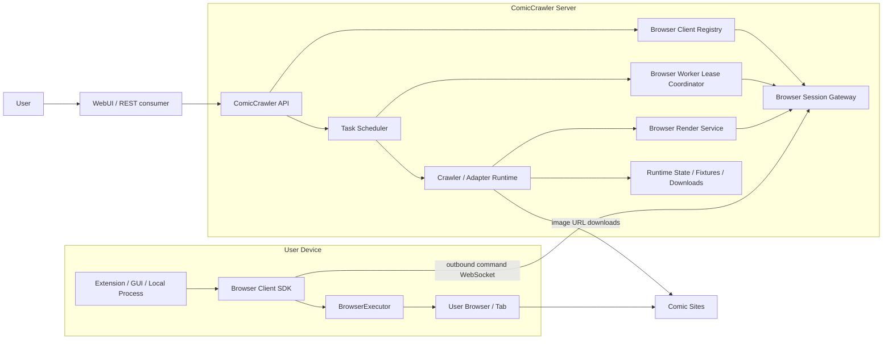
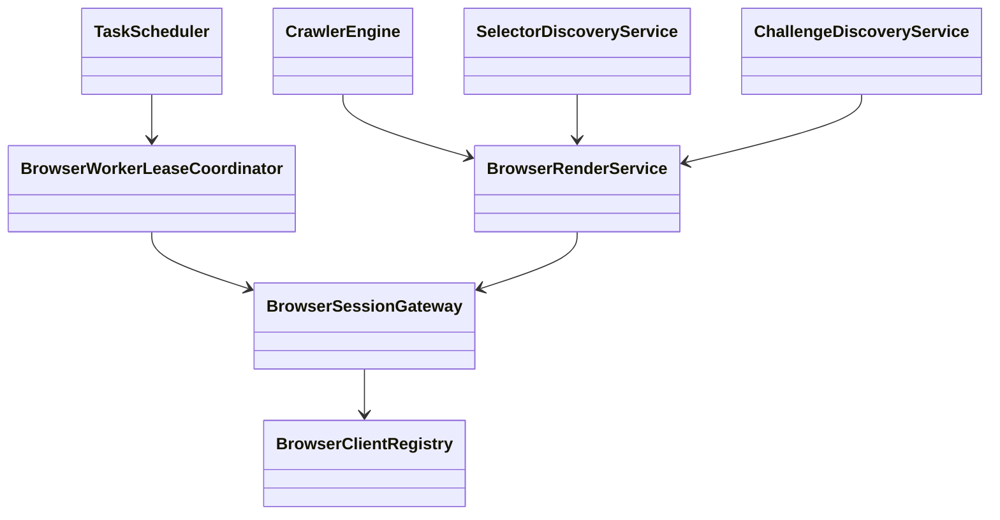
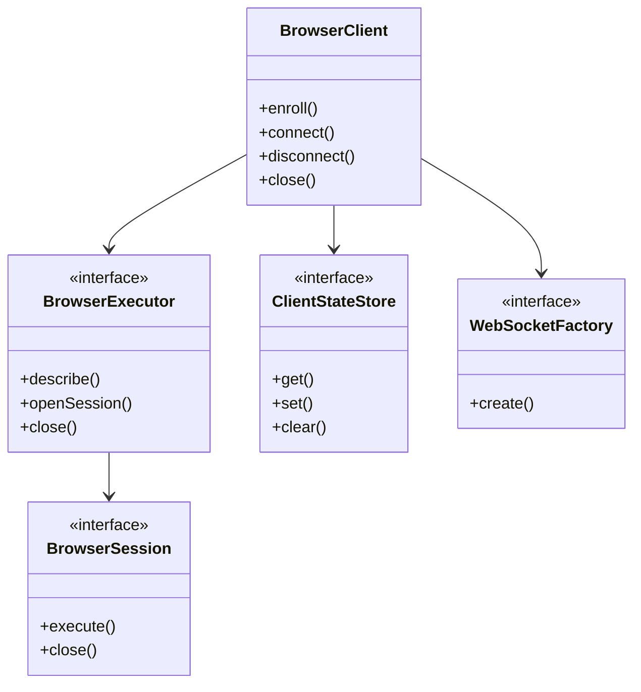
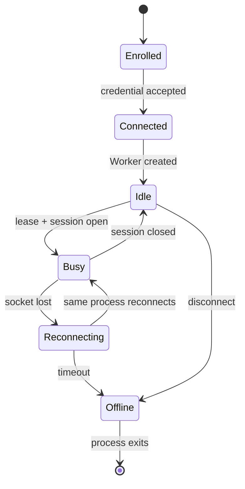
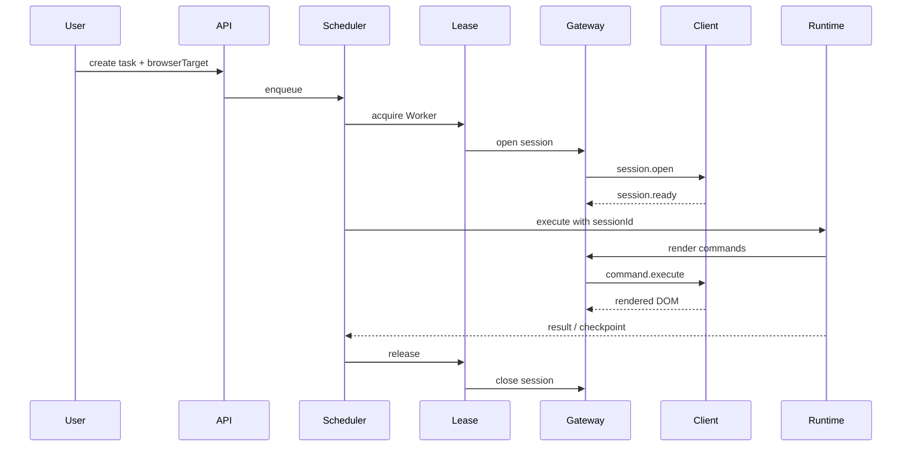

# Software Design Description

## 1. System context

The Server orchestrates work but never opens a browser. The consumer owns its
browser lifecycle. The command protocol returns rendered DOM and navigation
state; it does not expose arbitrary Playwright operations.

## 2. Component responsibilities

| Component | Responsibility |
|---|---|
| Browser Client Registry | Persists Client identity and credential hash. |
| Browser Session Gateway | Authenticates sockets and routes session commands. |
| Worker Lease Coordinator | Reserves one Worker for one task. |
| Browser Render Service | Composes navigation, readiness, and DOM commands. |
| Task Scheduler | Orders crawl and adapter jobs by policy. |
| Crawler Engine | Runs adapters and downloads image URLs. |
| Selector Discovery | Produces reviewable adapter drafts. |
| Challenge Discovery | Retains the session for human verification. |
| Browser Client SDK | Implements enrollment, connection, heartbeat, and dispatch. |
| BrowserExecutor | Consumer adapter for extension, CDP, or Playwright runtime. |

## 3. Server class relationships

## 4. Browser Client framework

The SDK has one package root and no Node, Playwright, or WebExtension runtime
dependency. Consumers inject platform-specific adapters.

## 5. Protocol

The discovery path is `/.well-known/comiccrawler-browser-client`. The command
socket is `/api/browser-clients/connect`.

The first Client frame is `client.authenticate`. After authentication:

1. Existing-tab Client may send `resource.register`.
2. Server acknowledges `resource.registered`.
3. Server sends `session.open` with an explicit source.
4. Client opens its browser session.
5. Client sends `session.ready`.
6. Server sends ordered `command.execute` frames.
7. Client sends `command.result` frames.
8. Server sends `session.close`.
9. Client releases session-owned resources.
10. Client sends `session.closed`.

Version 2 commands are:

- `page.navigate`
- `page.get-url`
- `page.get-content`
- `page.wait-for-ready`
- `page.prepare-content` with fixed `scroll-through` strategy
- `page.focus`

Content preparation belongs to Browser Client. Adapter capabilities receive the
prepared DOM and remain pure extraction code. Virtualized reader URLs remain in
`data-comiccrawler-src` or `data-comiccrawler-image-url` annotations.

## 6. Identity and lifecycle

Client ID is durable. Worker ID is tied to a Client process. Session and lease
IDs are task-scoped. Same-user simultaneous PC and mobile connections create
separate Workers without a device registry requirement.

## 7. Task flow

If verification is detected, Challenge Discovery retains the lease. `focus`
brings the same consumer-owned page forward. Resume detaches the retained lease
from the challenge job and continues the original task.

## 8. Scheduling

`SchedulingPolicy` is a Strategy. Sequential and concurrent policies decide
dispatch order. The Worker Lease Coordinator independently enforces one active
task per Worker and waits until timeout when no eligible Worker is idle.

## 9. Security

User API tokens authorize REST calls and enrollment. Client credentials only
authorize the Browser Client socket. The Server stores credential hashes. Every
session command is checked against Worker, session, and lease identity.

## 10. Persistence boundary

Durable Server state includes Client records, tasks, checkpoints, adapters, and
fixtures. Live sockets, Workers, leases, and sessions are process memory only.
Browser profile state belongs to the consumer and is never persisted by the
Server.
